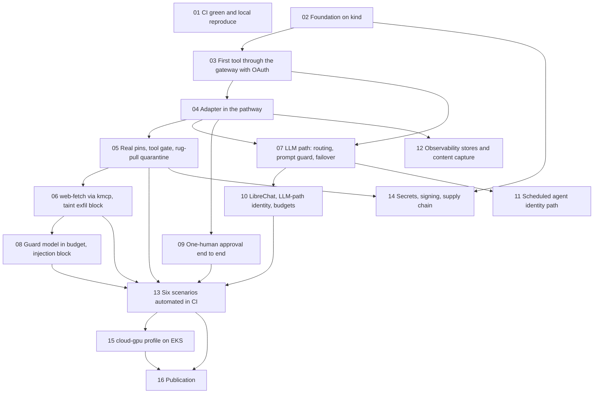

# Scaffold to POC: tickets

Tracer-bullet tickets that take the scaffold to a running, demonstrable proof of concept and
then to publication. Each ticket is a complete vertical slice that can be verified on its own,
sized for one working session. Blockers are listed per ticket; any ticket whose blockers are
done can start.

| # | Ticket | Blocked by |
|---|---|---|
| 01 | CI green and reproducible locally | none |
| 02 | Foundation bring-up on kind | none |
| 03 | First tool through the gateway with OAuth, no adapter | 02 |
| 04 | Adapter in the pathway with real request and response context | 03 |
| 05 | Real pins, a working tool gate, and the rug-pull quarantine (scenario 1) | 04 |
| 06 | web-fetch through kmcp and the taint exfiltration block (scenario 3) | 05 |
| 07 | LLM path: routing callout, prompt guard, failover (scenario 4) | 03, 04 |
| 08 | Guard model within the latency budget and the injection block (scenario 2) | 06 |
| 09 | One-human approval end to end (scenario 5) | 04 |
| 10 | LibreChat with Keycloak, identity on the LLM path, budgets (scenario 6) | 07 |
| 11 | Scheduled agent identity path | 07 |
| 12 | Observability stores, redaction and content capture | 04 |
| 13 | The six scenarios automated in CI | 05, 06, 08, 09, 10 |
| 14 | Secrets seeding, bundle signing, admission verification, delegated credentials | 02, 05 |
| 15 | cloud-gpu profile on EKS | 13 |
| 16 | Publication | 13, 15 |

Frontier at the start: 01 and 02 can run in parallel.
