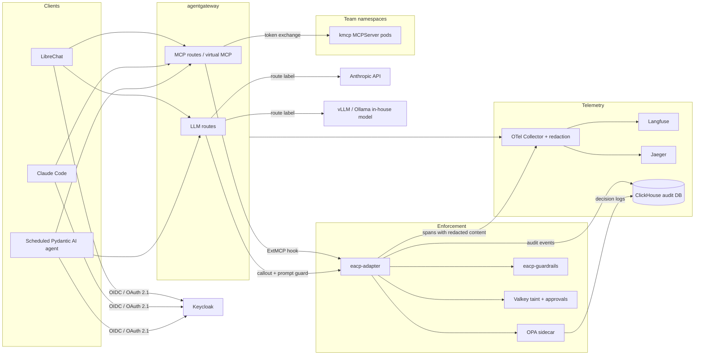

# Enterprise AI Control Plane (eacp)

A reference architecture and runnable proof of concept for **secure, compliant, controlled
enterprise AI with MCP tools**, built only from open-source components.

One gateway for LLM and MCP traffic. One policy engine for every prompt and every tool call.
One identity chain from the human to the tool. One pull request to onboard a new tool.

> Status: scaffold. The design is agreed and recorded in [docs/design.md](docs/design.md) and
> the [ADRs](docs/adr/README.md). Policies, schemas, the Helm chart, the adapter and the guardrail
> service exist as verified skeletons. Nothing has been deployed to a cluster yet. See
> [What is verified](#what-is-verified-and-what-is-not).

---

## Why this exists

Enterprises adopting agents hit the same four walls: every tool integration is a bespoke
security review, nobody can prove which human authorised which tool call, prompts with customer
data leak to whichever model the client picked, and the audit trail lives in five vendor
consoles. Commercial "AI gateways" answer parts of this. This repository answers all of it with
components you can read, fork and run, and documents every rejected alternative with the license
or feature-gate that excluded it.

## Architecture



| Role | Component | License |
|---|---|---|
| LLM gateway and MCP gateway | [agentgateway](https://agentgateway.dev) (Agentic AI Foundation, Linux Foundation) | Apache-2.0 |
| MCP server runtime for stdio servers | [kmcp](https://kagent.dev/docs/kmcp) `MCPServer` | Apache-2.0 |
| Policy decision point | [Open Policy Agent](https://www.openpolicyagent.org) | Apache-2.0 |
| Policy enforcement orchestrator | `eacp-adapter` (this repo, Go) | Apache-2.0 |
| Guardrails: PII, secrets, injection, sensitivity | `eacp-guardrails` (this repo, Python) with Presidio, GLiNER2-PII, gitleaks rules, Qwen3Guard-Gen, Granite Guardian, Lev | MIT / Apache-2.0 |
| Identity | Keycloak | Apache-2.0 |
| LLM observability and infrastructure tracing | Langfuse, Jaeger, OpenTelemetry Collector | MIT core, Apache-2.0 |
| Audit store, session state | ClickHouse, Valkey | Apache-2.0, BSD-3 |
| Secrets | OpenBao, External Secrets Operator | MPL-2.0, Apache-2.0 |
| Admission, GitOps, supply chain | Kyverno, Argo CD, cosign, Trivy, mcp-scanner, Conftest | Apache-2.0 |
| Clients | LibreChat, Pydantic AI, Claude Code | MIT, MIT, n/a |

The full bill of materials, with every rejected alternative and the reason, is in
[docs/design.md](docs/design.md#2-component-bill-of-materials).

## What the demo proves

Six scenarios, each one a policy test fixture, an end-to-end test, and a stage demo:

1. **Rug-pull quarantine.** A server changes a tool description after onboarding. The adapter
   hashes every `tools/list`, finds the pinned hash no longer matches, and quarantines the server.
2. **Indirect prompt injection in a tool result.** A fetched web page carries instructions. The
   guardrail classifier flags it; policy blocks the result and taints the conversation.
3. **Session-taint exfiltration block.** The agent read a customer record. Its next call to an
   exfiltration-capable tool is denied, even though that call looks harmless on its own.
4. **Classification-aware model routing.** A prompt touching restricted data is routed to the
   in-house model by the gateway's callout to the adapter. The trace proves where it went.
5. **Human approval on a high-risk tool.** Sending email requires one human approver from the
   tool owner's group. Deny with link, approve, retry succeeds, both events audited.
6. **Budget exhaustion.** A team's daily token budget runs out; the gateway denies with a clear message.

## Quick start (laptop profile)

Target: 16 GB RAM, 4 cores, no GPU. You bring Docker, `kind`, `kubectl`, `helm`, `jq`, Go 1.26,
Python 3.12 and an Anthropic API key for the external model. Everything else runs in the cluster.
On macOS with Homebrew and Docker Desktop (which ships `kubectl`), give Docker Desktop at least
12 GB of memory and install the rest with:

```bash
brew install kind helm go jq   # tested with kind 0.33.0 (Kubernetes 1.37), helm 4.3.1, go 1.27.3
```

```bash
make tools        # builds opa, buf and the protobuf generators (and helm if missing) into ./bin
python3.12 -m venv .venv && source .venv/bin/activate   # Homebrew and Debian Pythons refuse a system-wide pip install
pip install -e "guardrails[test]" jsonschema pyyaml
make test         # schemas, policy tests, chart render, adapter build and tests, guardrail tests, ADRs
export ANTHROPIC_API_KEY=...   # optional for the bring-up; the LLM path needs it
make up PROFILE=laptop
make demo
```

`make up` creates the kind cluster `eacp`, installs Argo CD, applies
`platform/argocd/root-laptop.yaml`, seeds OpenBao with the demo secrets
([scripts/seed-openbao.sh](scripts/seed-openbao.sh)) and returns when every Application in the
foundation and platform-store waves is Synced and Healthy (about 10 minutes on a first run, most of
it image pulls). Running it again is harmless; `make down` deletes the cluster. Argo CD syncs from
`main` on GitHub; to bring up another branch or a fork, push it and run
`EACP_REVISION=<branch> [EACP_REPO=<git url>] make up`.

| Host port | What | URL |
|---|---|---|
| 8080 | agentgateway | http://gw.127.0.0.1.sslip.io:8080 |
| 8081 | Keycloak (realm `eacp`; demo users alice, bob, carol with password `changeme-<name>`) | https://auth.127.0.0.1.sslip.io:8081 (CA in `.eacp/ca.pem`) |
| 8082 | Argo CD (user `admin`, password in the `argocd-initial-admin-secret` Secret) | http://127.0.0.1:8082 |

The same `auth.` and `gw.` names resolve inside the cluster (CoreDNS rewrite), so the Keycloak
issuer is identical for browsers and pods. Keycloak is served over https with a certificate from
a laptop CA that cert-manager creates; `make up` writes that CA to `.eacp/ca.pem`. A browser shows
a certificate warning unless you trust that file. Wave 0 and later (the eacp charts, models,
LibreChat, Langfuse) are later tickets and may not be healthy yet.

Until CI publishes images (ticket 05), `make up` builds the tickets server, the adapter and the
guardrail service locally and loads them into kind (`scripts/local-images.sh`). Tool manifests
still on the placeholder digest are not deployed. The laptop's policy bundle is built from the
checkout into a ConfigMap; after a policy change, `make policy-load` rebuilds it and restarts the
adapter. `make smoke` checks the gateway and identity path: protected-resource metadata, audience
checks, and tickets listed and called through `/mcp/tickets` and through `/mcp`.
`make pathway-cluster` checks enforcement: listings by entitlement, a denial with its code, the
audit rows, the trace in Jaeger, and that a stopped policy engine closes the gate.

### The pathway test, without a cluster

```bash
pip install -r test/pathway/requirements.txt
make pathway                       # about a minute
test/pathway/run.sh --clickhouse   # the same, plus the audit store in a ClickHouse container
make pathway-probe                 # prints what the gateway sends to the policy hook on each phase
```

`test/pathway/run.sh` starts the real agentgateway (Docker, or a binary in `EACP_AGENTGATEWAY`)
in front of the adapter, OPA, the guardrail service and the tickets server on one machine, and
checks the contract between the gateway's policy hook and the adapter: identity, trace context,
the metadata carried from the request phase to the response phase, listing filters and pins,
denials as the client sees them, audit rows and fail-closed behaviour. It takes about a minute
and runs in CI on every pull request. A new agentgateway version is tried here first.

### Connect Claude Code

Every MCP endpoint is an OAuth-protected resource whose metadata names Keycloak. Claude Code uses
the pre-registered public client `eacp-mcp-public` (Keycloak does not accept anonymous dynamic
registration) with a fixed callback port, and needs to trust the laptop CA because it refuses
to send credentials to a token endpoint that is not https:

```bash
claude mcp add --transport http --client-id eacp-mcp-public --callback-port 33418 tickets http://gw.127.0.0.1.sslip.io:8080/mcp/tickets
```

```bash
claude mcp add --transport http --client-id eacp-mcp-public --callback-port 33418 eacp http://gw.127.0.0.1.sslip.io:8080/mcp
```

```bash
NODE_EXTRA_CA_CERTS="$PWD/.eacp/ca.pem" claude
```

In Claude Code, run `/mcp`, choose the server and sign in as a demo user. The per-server route
shows `list_tickets`, `get_ticket`, `create_ticket` and `close_ticket`; the aggregate shows the
same tools prefixed `tickets_`. Tokens carry the `eacp-mcp` audience only; the gateway rejects
tokens minted for the LLM audience on MCP routes.

## Onboarding a tool in one pull request

A tool is one file: `tools/<name>/manifest.yaml`, validated by
[schemas/tool-manifest.schema.json](schemas/tool-manifest.schema.json).

```yaml
apiVersion: eacp.dev/v1alpha1
kind: ToolManifest
metadata:
  name: tickets
  team: support
  owner: support-platform@example.com
spec:
  image: ghcr.io/example/tickets-mcp@sha256:...
  transport: http
  tools:
    - name: create_ticket
      riskTier: medium
      capability: write
      outputClassification: internal
  pins:
    tools: sha256:...
```

On merge, CI has already scanned the image, verified its signature, scanned the tool
descriptions, pinned their hash and run the policy tests. Argo CD renders the
[`mcp-tool` chart](charts/mcp-tool) into a kmcp `MCPServer` or Deployment, a Service, an
`AgentgatewayBackend`, an `HTTPRoute`, the authentication and guardrail policies, a
`NetworkPolicy` egress allow-list and an `ExternalSecret`. Kyverno admits it only if the image is
signed and the pod is restricted. The tool appears in `tools/list` only for entitled groups.

## Repository map

| Path | What it is |
|---|---|
| `docs/design.md` | The agreed design, bill of materials, flows, decision log |
| `docs/adr/` | One ADR per decision, generated from `docs/adr/decisions.yaml` |
| `docs/threat-model.md`, `docs/control-mapping.md` | OWASP mapping and SOC 2 / ISO 42001 / EU AI Act mapping |
| `schemas/` | JSON schemas for tool, agent and team manifests |
| `tools/`, `agents/`, `teams/` | The manifests. The only files most contributors touch |
| `policies/` | OPA bundle: global, team, tool and agent layers, compiled data, tests and fixtures |
| `charts/mcp-tool` | Helm chart that expands a tool manifest into Kubernetes objects |
| `platform/` | Argo CD applications, gateway configuration, adapter and guardrail deployments, telemetry, Kyverno, Keycloak |
| `adapter/` | Go. agentgateway ExtMCP hook, LLM prompt guard and routing callout, OPA, taint, approvals, audit |
| `guardrails/` | Python. PII, secrets, injection, sensitivity and judge detectors behind one HTTP API |
| `demo/` | Demo MCP servers, LibreChat config, the scheduled agent, scenario runner |
| `test/pathway/` | The adapter behind a real agentgateway on one machine, without Kubernetes |
| `promptfoo/` | Nightly red-team configuration |
| `scripts/` | Manifest compilation, validation, bundle build, ADR generation, cluster bring-up |

## Policy model in one paragraph

Deterministic decisions live in OPA; probabilistic checks live in the guardrail service and only
produce findings. For every tool call the adapter runs guardrails on the arguments, loads the
conversation's taint labels, asks OPA for one decision document (`allow`, `reasons`,
`redactions`, `require_approval`, `route_label`, `taint_updates`), and fails closed if any piece
is unavailable. Policies are layered: global rules owned by security, then team, tool and agent
rules owned by their teams, enforced through `CODEOWNERS`. Every decision record carries the
policy bundle revision and the trace id.

## What is verified and what is not

Verified in this repository today: manifest schemas validate the demo manifests; the OPA policies
pass their unit tests against the six fixtures; the Helm chart renders for every demo manifest;
the Go adapter compiles and its unit tests pass; the Python guardrail service's tests pass. The
component facts in the design were verified against primary sources on 2026-11-06, with URLs in
`docs/research/`.

On a kind cluster (2026-11-07, macOS with Docker Desktop): `make up PROFILE=laptop` brings every
foundation and platform-store Application (sync waves -3 to -1) to Synced and Healthy with no manual
step, OpenBao is seeded and the ExternalSecrets resolve, Keycloak serves the `eacp` realm and a demo
user can log in, and the host ports above answer. Every chart and git source in `platform/argocd/`
is pinned to a release that exists.

On the same cluster (2026-11-08, ticket 03): the tickets server runs in `team-support` from its
manifest; Claude Code signs in through Keycloak and lists and calls the tickets tools through
`/mcp/tickets` and through the aggregate `/mcp`; `make smoke` passes; a token for the MCP
audience is accepted on MCP routes and a token for the LLM audience or no gateway audience is
rejected.

Against agentgateway 1.7.0 on one machine (2026-11-11, ticket 04, `test/pathway`): the adapter
receives the caller's verified claims and the trace context on both hook phases, and the response
phase receives the tool name and conversation id the request phase stashed; listings show a
caller only entitled tools, on the per-server route and on the aggregate, under one pin; a denied
call reaches an MCP client with its `eacp_code` and conversation id; every phase writes one audit
row, also into ClickHouse with the cluster's schema and its insert-only user; one call is one
trace with the adapter's spans under the gateway's; a stopped OPA or adapter closes the gate.

Not yet verified for ticket 04: the same on the kind cluster. The charts, `make up` and
`make pathway-cluster` are written for it and render, but have not run against a cluster.

Not yet done: models, Langfuse and the demo Applications do not sync yet; later tickets in
`.scratch/scaffold-to-poc/` bring them up. The build-time spikes listed in
[docs/design.md section 11](docs/design.md#11-open-items-to-confirm-or-spike-before-building) are
open. Fields still marked `TODO(verify)` in `platform/` name CRD details to confirm against a
running agentgateway and kmcp; the gateway and tool charts have none left.

## License

Apache-2.0. The vendored `adapter/proto/extmcp/ext_mcp.proto` is from the agentgateway project,
also Apache-2.0; its license text is kept next to it.
