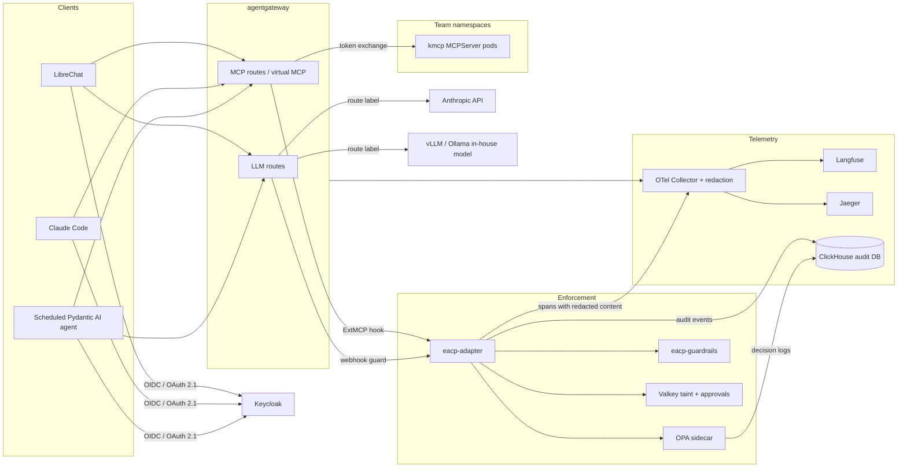

# Enterprise AI Control Plane (eacp): consolidated design

Status: design agreed across three grilling rounds on 2026-11-06, open items confirmed, Jev placement recorded. The repository scaffold that implements it is described in the top-level README; the per-decision records are in `adr/`.
Purpose: a published, open-source reference architecture plus a runnable proof of concept
for secure, compliant, controlled enterprise AI with MCP tools.

Every product fact below was verified on 2026-11-06 from LICENSE files, release pages and
official docs. The four research reports with per-claim URLs are in `research/`.

---

## 1. Goals, audience, rules

| Topic | Decision |
|---|---|
| Deliverable | GitHub repo `enterprise-ai-control-plane` (Apache-2.0) plus a long-form article. README is the article's skeleton. |
| Audience | Primary: platform and security architects. Secondary: engineers who clone and run it. |
| "Open source" rule | OSI-approved licenses only, plus open-core projects when every feature used is in the OSI-licensed tier (boundary documented per component). AGPL allowed only for standalone services, never linked code. Source-available licenses (ELv2, BUSL, custom) excluded. Control plane is open source; models are mixed: Anthropic via the gateway plus one self-hosted open-weight model. |
| Deployment | Kubernetes only, cloud-agnostic. `laptop` profile on kind, `cloud-gpu` profile tested on EKS. No docker-compose path. |
| Threat taxonomy | OWASP Top 10 for LLM Applications and OWASP Agentic AI Top 10. |
| Compliance mappings | SOC 2 control families, ISO 42001, EU AI Act Article 12 record keeping. HIPAA and PCI as extension notes. |
| Glue code budget | One Go adapter, one Python guardrail service, a tiny approval page, a Helm chart and CI scripts. About 2,500 to 3,000 lines, published in the repo. |
| Multi-tenancy | Team is a first-class dimension from day one: claims to groups to tool entitlements, budgets and trace visibility. One Kubernetes namespace per team for MCP servers plus a platform namespace. |
| Attribute namespace | `eacp.` prefix on custom span and audit attributes. |

---

## 2. Component bill of materials

| Box | Product | License | Governance | Why |
|---|---|---|---|---|
| AI gateway and MCP gateway (one product, two roles) | agentgateway v1.7 | Apache-2.0 | Linux Foundation, Agentic AI Foundation | Tracks MCP spec 2026-07-28, OAuth resource-server role with Keycloak preset, upstream token exchange, gRPC pre/post tool hook that can mutate or deny, LLM routing with failover, virtual models, token budgets by JWT claim, OpenTelemetry. Agent Router is the documented drop-in for the LLM box. |
| MCP server runtime | kmcp `MCPServer` CRD v0.10 | Apache-2.0 | kagent project, CNCF | Containerizes stdio servers with a transport-adapter sidecar. agentgateway's CRD cannot run stdio servers itself. |
| Policy decision point | Open Policy Agent v1.22 | Apache-2.0 | CNCF graduated | Rego handles claims, JSON, regex and text natively; decision logs with masking; signed OCI bundles. One PDP, one policy repo, two enforcement points. |
| Policy enforcement orchestrator | `eacp-adapter` (Go, written in this repo) | Apache-2.0 | this project | Implements agentgateway's ExtMCP hook and LLM webhook guard. Runs guardrails, taint, OPA, approval and audit per call. OPA is its sidecar. |
| Guardrail service | `eacp-guardrails` (Python, written in this repo) | Apache-2.0 | this project | Composes Presidio with the GLiNER2-PII recognizer, gitleaks rules, Qwen3Guard-Gen, and Granite Guardian 4.1 as optional judge. |
| Identity provider | Keycloak 26.8 | Apache-2.0 | CNCF incubating | Token exchange GA, Kubernetes service-account federation GA, delegation with `act` claim in preview, Identity Assertion grant experimental, AuthZEN experimental. |
| Workload identity, POC | Kubernetes service-account tokens federated into Keycloak | n/a | n/a | GA path. SPIRE documented as the multi-cluster extension. |
| LLM observability | Langfuse v4 | MIT core, `ee/` commercial | ClickHouse Inc. | OTLP ingestion, tool spans, sessions, cost; OIDC SSO and org roles free. Project roles, retention and server-side masking are enterprise, handled elsewhere (see section 7). |
| Infrastructure tracing | Jaeger v2.23 | Apache-2.0 | CNCF graduated | Renders every span including gateway, Keycloak and OPA. Badger store in POC, OpenSearch in production notes. |
| Telemetry pipeline | OpenTelemetry Collector contrib with redaction processor | Apache-2.0 | CNCF | Fan-out to Langfuse and Jaeger; redaction before storage. |
| Audit store | ClickHouse, separate database, insert-only role | Apache-2.0 | ClickHouse Inc. | Already required by Langfuse. Production note: daily export to object-locked storage owned by a different team. |
| Session state | Valkey | BSD-3 | Linux Foundation | Taint labels and pending approvals. Redis 8 is not OSI. |
| Secrets | OpenBao 2.7 single node with integrated Raft, plus External Secrets Operator | MPL-2.0, Apache-2.0 | Linux Foundation, CNCF | Smallest footprint of any real secrets manager. |
| Admission policy | Kyverno 1.19 | Apache-2.0 | CNCF graduated | Verified images only, restricted pod security, NetworkPolicy must exist. |
| GitOps | Argo CD 3.6 | Apache-2.0 | CNCF graduated | ApplicationSet directory generator: one application per tool directory. |
| Supply chain | cosign (Sigstore), Trivy, Cisco mcp-scanner, Conftest | Apache-2.0 all | various | Trivy pinned by digest and cosign-verified after its March 2026 incident; Grype and Syft documented as alternatives. |
| Chat UI | LibreChat 0.8 | MIT | community | OIDC login, remote MCP over OAuth, OTLP traces, Helm chart. Caveats: no elicitation, MCP SDK at spec 2025-11-25, no Client ID Metadata Documents. |
| In-cluster agent | Pydantic AI | MIT | Pydantic | MCP client with OAuth, native GenAI-convention OpenTelemetry. Runs as a scheduled autonomous agent. |
| IDE client | Claude Code | n/a | Anthropic | The one tested IDE path. |
| Models, laptop profile | Ollama serving a small Qwen3 general model and Qwen3Guard-Gen 0.6B from a community GGUF; judge disabled | MIT, Apache-2.0 | | Qwen3Guard is not in Ollama's official library. |
| Models, cloud-gpu profile | vLLM serving Qwen3Guard-Gen 4B, Granite Guardian 4.1 8B and a larger in-house model | Apache-2.0 | | NVIDIA GPU Operator on EKS. |
| Optional sensitivity labeller, cloud-gpu profile | Lev (open Jev clone) | Apache-2.0 | Interfaze | Zero-shot label over the four sensitivity classes, behind a flag. See section 11a. |
| External model | Anthropic only | n/a | | Failover between two Anthropic models, then the in-house model for non-restricted traffic. |
| Red-team and evals | promptfoo (MCP provider and red-team plugin), Inspect optional | MIT | | Nightly in CI. |
| Demo targets | bytebase/dbhub over PostgreSQL, reference `fetch` server via kmcp, Mailpit, a small tickets server and a deliberately poisoned server written as demo code | MIT and Apache-2.0 | | Demo servers are demo code, outside the glue budget. |

Knocked out, with the reason, for the article's rejected-options table: the registry originally
proposed (no runtime policy hook), ToolHive (embedded Cedar contradicts one-PDP, enterprise-gated
group mapping and audit, 0.x), IBM ContextForge (no operator, fail-open revocation), LiteLLM (JWT
auth and audit logs enterprise), Kong (no free tier after 3.9), Portkey (idle after acquisition),
TensorZero (archived), Helicone gateway (GPL license file), Arize Phoenix (Elastic license),
SigNoz (OIDC enterprise), Opik (no user management), Zitadel (AGPL), Authentik (agent accounts
enterprise), Ory Hydra (no token exchange), Cedar as central PDP (no open-source AuthZEN PDP),
LLM Guard and OpenShield (archived), Llama Guard and Prompt Guard (non-OSI license), NeMo
Guardrails (application-side orchestrator, own DSL), Open WebUI and Lobe Chat (non-OSI licenses),
MongoDB and MinIO (see open items), HashiCorp Vault (BUSL), Infisical (footprint), Redis 8 (non-OSI).

---

## 3. Architecture

Both gateway roles live in one agentgateway deployment. The diagram keeps them as two boxes
because the roles differ and Agent Router can replace the LLM box.

---

## 4. Identity

- **One Keycloak realm.** Groups are teams. Clients: LibreChat (confidential), one client per
  agent with a service account and an `owner` attribute, and two resource audiences for the
  gateway: `eacp-mcp` and `eacp-llm`. Token claims: `groups`, `team`, `clearance`. The realm is
  created from a realm-import resource by the Keycloak operator, generated from the manifests.
- **Users.** OIDC login to LibreChat. LibreChat's MCP client runs the spec's OAuth 2.1 flow
  against agentgateway's MCP endpoint: protected resource metadata, authorization-server
  discovery, PKCE, resource indicator. agentgateway proxies dynamic client registration to
  Keycloak; Client ID Metadata Documents are accepted as clients adopt them.
- **Agents.** Every token carries the user subject plus an actor chain (user, then agent, then
  gateway) via Keycloak's preview delegation flow (RFC 8693 actor token, `act` claim). Fallback
  behind a flag: user token in the bearer header, agent workload token in a second header the
  adapter validates. Scheduled agents get a service identity through Kubernetes service-account
  token federation; the manifest names a human owner.
- **Identity on the LLM path.** JWT first; otherwise a user-id header trusted only when the
  caller is LibreChat's own service identity. Gateway CEL resolves the effective user and team;
  budgets key off that.
- **Upstream.** agentgateway performs RFC 8693 token exchange per backend so each MCP server
  receives a token scoped to itself; token passthrough is forbidden by the spec and by policy.
- **Enterprise-Managed Authorization** (Identity Assertion grant, stable MCP extension,
  experimental in Keycloak 26.7+) is shown behind an optional flag, not in the main demo.

---

## 5. Policy pathway

### 5.1 Split of responsibilities
- **Deterministic decisions** live in OPA: claims, groups, manifest attributes, JSON shapes,
  regexes, text matches, taint, findings.
- **Probabilistic checks** live in the guardrail service: PII, secrets, injection and jailbreak
  classification, optional judge. They emit structured findings; they never decide.
- **The adapter** orchestrates: guardrails, taint read, OPA, taint write, approval, audit,
  content span. Fail closed on any component failure.

### 5.2 Tool call, request phase
1. agentgateway validates the JWT, applies coarse CEL rules, calls the adapter's ExtMCP hook with
   method, target, params, allow-listed request headers (including trace context and baggage) and
   a CEL metadata block carrying the JWT claims.
2. Adapter: verify the server's pinned tool hash is current; run guardrails on the arguments; load
   taint for the conversation; build the OPA input; evaluate.
3. Outcomes: pass, mutate (redacted arguments), deny with reason, or deny with an approval link.
4. Audit event written; span emitted with redacted content.

### 5.3 Tool call, response phase
1. Hook receives the result and the CEL metadata block (no headers in this phase; trace context
   and conversation id come through metadata).
2. Guardrails on the result: injection in untrusted content, PII, secrets.
3. OPA post-decision: pass, redact, or deny. Taint updated: `touched_pii`, `touched_restricted`,
   `touched_untrusted_content`. Audit and span.
4. Tool errors skip the response hook; their audit comes from gateway access logs.

### 5.4 LLM call
1. agentgateway's webhook guard sends prompt to the adapter.
2. Guardrails on the prompt; classification label computed as the maximum of the tool manifest's
   output class, the findings, and the token's clearance, across the conversation's taint.
3. OPA decides which model classes this team may use for this label; returns a route label.
4. agentgateway virtual-model routing: `restricted` and `confidential` go only to the in-house
   model; `internal` and `public` go to Anthropic with failover to a second Anthropic model and
   then to the in-house model.
5. Response guarded, span with redacted content, cost attributed to user and team.

### 5.5 Session taint
- Session key: W3C baggage `conversation_id` set by the client; fallback is the user subject and
  agent client id with a 30-minute sliding window. Stored in Valkey.
- Tools declare a capability class in the manifest: `read`, `write`, `exfil-capable`,
  `destructive`. The headline policy: no `exfil-capable` tool after `touched_restricted` in the
  same conversation.

### 5.6 OPA decision contract
Input: subject (sub, groups, team, clearance, act chain), agent manifest, tool manifest (server,
tool, risk tier, capability class, output classification), arguments, findings, taint, request
metadata (conversation id, trace id, phase).
Output: `allow`, `reasons[]`, `redactions[]`, `require_approval{approver_group}`,
`route_label`, `audit_tags[]`.

### 5.7 Human in the loop
One approval by one human. The approver comes from the tool manifest's approver group, defaulting
to the tool's owning team. A per-tool flag permits self-approval, off by default. Mechanism:
adapter denies with a structured error containing an approval URL and request id; pending request
stored in Valkey; approver authenticates to the adapter's approval page via Keycloak and approves;
the agent retries and the adapter matches the request hash within a TTL. Both events are audited
with the approver's identity. The spec-native flow (elicitation plus the Tasks extension's
input-required state) is implemented behind a flag and marked experimental, because LibreChat
cannot render elicitation.

### 5.8 Latency and failure budgets
Deterministic checks plus OPA under 20 ms. ML classifiers under 200 ms synchronous. Judge model
only for tools tagged high-risk; asynchronous and alert-only elsewhere. Every hook is configured
`failClosed`.

---

## 6. Tool onboarding

### 6.1 Acceptance test
Merging one pull request containing one manifest results, within ten minutes and with zero manual
steps, in: container deployed and sandboxed, server registered and health-checked, tools visible
only to entitled groups, policies active, traces flowing.

### 6.2 The manifest
`tools/<name>/manifest.yaml`, validated against a JSON schema: image by digest, transport,
owner and team, per-tool risk tier, output classification, capability class, egress hosts,
required groups, credential mode (`service` or `delegated`), approval mode and approver group,
and the pinned SHA-256 of tools, prompts and resources.

### 6.3 Expansion
A Helm chart in the repo renders from the manifest: kmcp `MCPServer` (or a Deployment for
HTTP-native servers), Service, `AgentgatewayBackend`, `HTTPRoute`, `AgentgatewayPolicy`
(authentication, authorization, hook), NetworkPolicy with the egress allow-list, and an
ExternalSecret. The manifest is also compiled into the OPA data bundle.

### 6.4 CI gate before merge
Schema validation with Conftest, cosign verification of the image, Trivy scan, Cisco mcp-scanner
over the tool descriptions, hash pinning check, `opa test`. Kyverno enforces at admission:
verified images only, restricted pod security, NetworkPolicy present.

### 6.5 Rug-pull detection
The adapter hashes every tools, prompts and resources listing and compares with the pinned hash.
On mismatch the server is quarantined: all calls denied, alert raised, audit event written, until
a new manifest is merged.

### 6.6 Tool scoping
What a client sees in tools/list is the intersection of the user's group entitlements and the
agent manifest's declared tool set, enforced by the adapter on the list response. agentgateway
prefixes tool names by server to prevent collisions. Semantic tool search is an extension.

### 6.7 Downstream credentials
Manifest chooses per tool. Default: a service credential from OpenBao delivered by External
Secrets Operator. One demo tool uses per-user delegation through Keycloak brokering and token
exchange so the downstream system sees the real user.

---

## 7. Telemetry and audit

- **Traces.** One trace per user turn, rooted in the client. agentgateway spans and child spans
  per policy call. Adapter continues the trace and adds child spans for guardrails, OPA, taint and
  audit. Langfuse session is the conversation id. Everything sampled in the POC.
- **Content.** Captured only in the adapter, after one redaction pass, as opt-in GenAI span
  attributes. Client instrumentation is metadata-only by default, as the OpenTelemetry GenAI
  conventions recommend. Content capture is a per-environment switch, on in the POC.
- **Collector.** Redaction processor masks PII and drops secrets before storage; fan-out to
  Langfuse (GenAI spans) and Jaeger (all spans).
- **Audit.** OPA decision logs with masking plus adapter audit events go to a separate ClickHouse
  database with an insert-only role. Each record carries the subject and actor chain, team, tool
  or model, decision, reasons, policy bundle revision, findings, latency and trace id. Unsampled.
- **Per-team visibility.** One Langfuse organization per team, because project roles are
  enterprise. Retention is a ClickHouse TTL, documented as a free-tier gap.
- **Cost.** agentgateway enforces token budgets per user and per team per day; Langfuse reports
  currency. Exhaustion is a deny with a clear message.

---

## 8. Policy repository and CI

- Monorepo layout: `platform/`, `policies/`, `tools/`, `agents/`, `adapter/`, `guardrails/`,
  `docs/`. CODEOWNERS gives the security team `policies/00-global/`, tool owners their own
  `tools/<name>/`, team leads `policies/10-teams/<team>/`.
- Policy layers: global guardrails, team policies, per-tool policies, per-agent policies. Rego v1.
  One decision document. A unit-test fixture per demo threat. Bundles signed; revision is the git
  commit and appears in every audit record; pushed to an OCI registry; OPA pulls.
- Agent manifests in `agents/<name>/manifest.yaml`: owner, team, risk tier, allowed tool groups,
  allowed model classes, schedule. Keycloak clients derive from them.
- GitHub Actions. Per pull request: schema validation, policy unit tests, image build with
  keyless cosign signing, Trivy, end-to-end on kind running the five threat scenarios. Nightly:
  promptfoo red-team against the LLM route and the MCP endpoint; Inspect optional.
- Argo CD syncs the platform and, via an ApplicationSet directory generator, one application per
  tool directory.

---

## 9. Demo

Domain: a customer-support engineer's agent. Tools, all self-hosted: customer database over
PostgreSQL (restricted data), tickets, web fetch, email send backed by Mailpit, and one
deliberately poisoned third-party server.

The five threats shown on stage, plus one quick one:
1. Rug-pull quarantine: a server changes a tool description; calls are denied and the audit shows why.
2. Indirect injection in a tool result: detected, result annotated or blocked.
3. Session-taint exfiltration block: after reading a customer record, web fetch is denied.
4. Classification routing: a restricted prompt goes to the in-house model; the trace proves it.
5. Human approval on email send: deny with link, approver approves, retry succeeds.
6. A team token budget runs out.

---

## 10. Out of scope, documented as extensions

RAG and permission-aware retrieval, Agent-to-Agent protocol gateway, semantic cache with
tenant-scoped keys, semantic tool search, SPIRE for multi-cluster workload identity, full
information-flow control, service mesh, currency-budget enforcement, Enterprise-Managed
Authorization as the main flow.

---

## 11. Open items to confirm or spike before building

These were not decided in the rounds, or depend on a fact only a build can verify.

1. **LibreChat requires MongoDB, whose SSPL license is not OSI-approved.** Hugging Face chat-ui
   has the same dependency. Options: spike FerretDB (Apache-2.0, PostgreSQL-backed, Mongo wire
   protocol) as the backend; or accept MongoDB as the single documented non-OSI exception,
   confined to the demo UI and not the control plane. Recommendation: spike FerretDB first, fall
   back to the documented exception.
2. **Langfuse needs S3-compatible blob storage and a Redis-compatible cache.** MinIO's community
   edition is no longer a credible choice. Recommendation: SeaweedFS (Apache-2.0) for S3 and
   Valkey for cache, both to be verified against Langfuse at build time.
3. **In-cluster transport security.** Not discussed. Recommendation for the POC: TLS terminates
   at agentgateway, cert-manager (Apache-2.0) issues internal certificates, Kyverno-required
   NetworkPolicies isolate namespaces, and a service mesh (Istio ambient or Cilium) is an
   extension, not a component.
4. **Metrics and dashboards.** Not discussed. Recommendation: Prometheus (Apache-2.0) scraping
   agentgateway and the adapter, Grafana (AGPL, standalone service, allowed) for one dashboard.
5. **Build-time spikes:** that agentgateway's CEL metadata block can carry trace context and
   conversation id into the response-phase hook; that LibreChat's placeholder headers can forward
   a per-user token on the LLM path; that Keycloak's preview delegation flow issues the `act`
   claim as expected with agentgateway's token exchange; that Qwen3Guard-Gen 0.6B meets the
   200 ms budget on a laptop CPU.
6. **Laptop profile sizing.** Target: 16 GB RAM, 4 cores, no GPU. Confirmed.
7. **Demo tool servers** are written with FastMCP (Apache-2.0) as demo code outside the glue budget. Confirmed.
8. **Laptop-profile injection classifier alternative.** Red Hat's October 2026 benchmark measured a
   roughly 200M-parameter DeBERTa prompt-injection classifier at 89% accuracy and 54 ms median
   latency, which beats every larger model tested on CPU-class latency. Verify its license and, if
   permissive, offer it as the laptop-profile default ahead of Qwen3Guard-Gen 0.6B. Qwen3Guard stays
   the cloud-gpu choice because it also covers jailbreak and multilingual cases.

---

## 11a. Resolved: the "Yev" question is Jev, and where it fits

The model is **Jev** by TypeSafe AI, released 2026-09-15: a "decision model" that takes a state
(text or JSON) plus typed questions (yes/no, choice over labels you supply, or score) and returns
the winning label with per-option probabilities and a confidence. It is proprietary, API-only,
early access, priced at $0.042 per million input tokens, 70 to 500 ms latency, no documented EU
operation. It therefore fails three agreed rules: the open-source rule, the 200 ms synchronous
budget for classifiers, and data residency, since sending restricted text to a hosted classifier
is the exact leak the classification routing exists to prevent.

Open clones, verified 2026-11-06:

| Clone | License | Base and size | Fit |
|---|---|---|---|
| Lev (Interfaze) | Apache-2.0 | Qwen3.5-4B plus LoRA; one GPU; seconds per call on CPU | Mimics Jev's API (`/v1/systemone`). Fits the cloud-gpu profile only. |
| Laya | not stated | about 421M, ModernBERT backbone | Fast (about 119 ms) but weak on content safety at default policy. License must be verified before use. |
| Kev (Palmer) | Apache-2.0 | Qwen 3.5, three sizes | Contamination flagged by a competitor's board; no independent test. |
| djev (Maisa) | Apache-2.0 | 26B Gemma diffusion | Too large for this POC. |

Red Hat's benchmark of decision models against guardrails (2026-10-02) concluded they do not
reliably beat small pre-trained classifiers or LLM-as-judge in speed or accuracy, and recommends
pre-trained classifiers for CPU-scale guardrails, with zero-shot decision models only where no
pre-trained classifier exists.

**Placement decided:** Lev is the optional fourth classification source from Q28 and Q37, behind a
flag, cloud-gpu profile only, used for one job: zero-shot sensitivity labelling of free text with
a choice question over `public`, `internal`, `confidential`, `restricted`, merged with max
semantics. It is never used for injection, PII or secrets, where pre-trained classifiers win, and
Jev's hosted API is never on the path. Operating rules carried into the guardrail service:
thresholds set from a few hundred of the team's own labelled samples, model version and timestamp
recorded in every finding, label order fixed because reordering shifts scores, English only
unless validated otherwise.

---

## 12. Decision log (seed for the ADRs)

| # | Decision | Rejected alternatives |
|---|---|---|
| 1 | Repo plus article, architects as primary audience, Apache-2.0 | Talk only, sales asset |
| 2 | OSI-only plus open-core with documented boundary; AGPL standalone only; no source-available | Allow ELv2 or BUSL |
| 3 | Kubernetes only, cloud-agnostic, kind for laptop, EKS for GPU | docker-compose, dual path |
| 4 | LibreChat and a scheduled in-cluster agent fully; Claude Code as tested IDE path | IDE-first |
| 5 | OWASP LLM and Agentic Top 10; SOC 2, ISO 42001, EU AI Act Art. 12 | Unmapped "compliance" |
| 6 | User plus actor chain in every token; scheduled agents have service identity and named owner | Delegation only, agent-only |
| 7 | Deterministic PDP separated from probabilistic guardrails; one PDP, two enforcement points, one policy repo | Classifiers inside OPA, two PDPs |
| 8 | Session taint tracking | Stateless only, full information-flow control |
| 9 | Redact at collector; separate append-only audit log; content capture is a switch | Capture all, metadata only |
| 10 | Fail closed everywhere; 20 ms, 200 ms, judge only for high-risk | Fail open with alert |
| 11 | Anthropic plus one in-house model; classification-aware routing | External only |
| 12 | In scope: secrets, hardening and supply chain, HITL, red-team CI, cost controls, GitOps. Out: RAG, A2A, semantic cache | |
| 13 | Small published adapter layer; two boxes, one product | Zero custom code |
| 14 | Named products treated as candidates; OPA chosen | Cedar as central PDP |
| 15 | Onboarding acceptance test with CI security gate | No gate |
| 16 | Team as first-class dimension | Single tenant |
| 17 | agentgateway plus kmcp | ToolHive, ContextForge, the originally named registry |
| 18 | One gateway product | Agent Router as separate LLM gateway |
| 19 | Adapter as single enforcement orchestrator; Go adapter, Python guardrails; 2.5 to 3k lines | ext_authz chain |
| 20 | Langfuse plus Jaeger via collector fan-out | Opik, Phoenix, SigNoz |
| 21 | Content captured only in the adapter; clients metadata-only | Client-side capture |
| 22 | ClickHouse audit database with insert-only role | OpenSearch, Loki, object lock |
| 23 | Keycloak; preview delegation primary, two-header fallback; K8s SA federation; SPIRE extension | Zitadel, Authentik, Ory |
| 24 | Git manifests as source of truth; Keycloak derived | Keycloak attributes, custom operator |
| 25 | Helm chart expansion; Kyverno; Trivy pinned and verified; mcp-scanner | Kustomize, custom CRD, Grype |
| 26 | Pin tools, prompts, resources; quarantine on mismatch | Warn only |
| 27 | Baggage conversation id, subject-agent fallback, Valkey | Custom header only |
| 28 | Four-level deterministic classification, max semantics | ML classifier in POC |
| 29 | Two profiles: laptop CPU via Ollama, cloud GPU via vLLM | Single profile |
| 30 | OpenBao single node plus External Secrets Operator | Infisical, SOPS |
| 31 | One human approver from manifest group; deny-with-link baseline; spec flow experimental | Two-person rule, Tasks-only |
| 32 | Entitlement intersect agent manifest; prefixed tool names | Semantic search |
| 33 | LibreChat, Pydantic AI, Claude Code | Open WebUI, chat-ui, LangGraph |
| 34 | Customer-support domain; five threats plus budget | |
| 35 | Argo CD, monorepo, namespace per team | Flux |
| 36 | `enterprise-ai-control-plane`, `eacp.` prefix | |
| 37 | Classification stays deterministic; Lev (Apache-2.0 Jev clone) is an optional flagged sensitivity-labelling source in the cloud-gpu profile | Jev hosted API (proprietary, latency, residency), decision models for injection or PII |
| 38 | Approver from manifest group, self-approval flag off | Requester consent only |
| 39 | EKS for the GPU profile | GKE, AKS |
| 40 | Anthropic only; model-level failover then in-house | Two commercial providers |
| 41 | JWT first, trusted header second on the LLM path | Service key only |
| 42 | Scheduled autonomous agent as second client | Interactive backend |
| 43 | One trace per turn; adapter continues trace; audit carries trace id | Trace per tool call |
| 44 | Layered policy repo, one decision document, Rego v1, fixtures per threat, signed bundles | |
| 45 | Token budgets enforced, currency reported | Currency enforcement |
| 46 | GitHub Actions; per-PR gate; nightly red-team | |
| 47 | Argo CD directory generator | Flux |
| 48 | Single realm, groups are teams, two audiences, operator realm import | Realm per team |
| 49 | Lumenalta org, cross-posted article, ADRs, short video | Personal org only |
